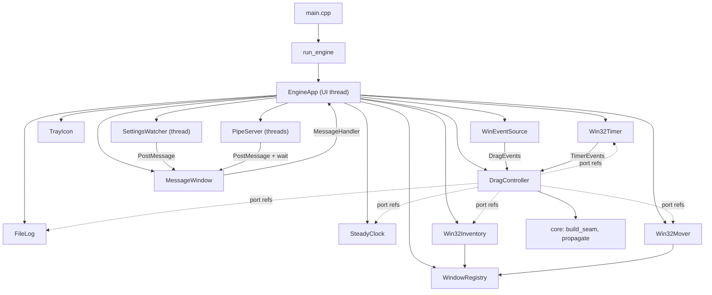

# C++ build reference

This page explains every type in `src/engines/cpp/` so the code can be read file by file. Behavior is defined in the [specs](../../spec/index.md). This page only describes how the C++ code implements it. Every header also carries `///` comments, so the code and this page tell the same story.

## Folder map

| Folder | CMake target | Layer | Depends on |
|---|---|---|---|
| `src/engines/cpp/core/` | `mb_core` | Domain: rectangles, seams, the glue algorithm. No OS types. | nothing |
| `src/engines/cpp/app/` | `mb_app` | Ports (pure virtual), `DragController`, settings, pipe protocol. No Win32 types. | `core` |
| `src/engines/cpp/win32/` | `mb_win32` | Adapters for the ports, hooks, tray, pipe, RAII handles. | `app`, `core` |
| `src/engines/cpp/host/` | `magnetic_borders` | Composition root (`engine_app.cpp`), `main.cpp`, manifest, resources. | all |
| `src/engines/cpp/fixture-runner/` | `mb_fixture`, `fixture_runner` | Parses `tests/fixtures/*.layout` and checks the domain. `mb_fixture` is the library, `fixture_runner` the console tool. | `core` |
| `src/engines/cpp/tests/` | `mb_tests` | GoogleTest: domain, controller with fake ports, settings, pipe, fixtures, and the Win32 adapters. | `app`, `mb_fixture`, `win32` |

The `core`, `app`, and `fixture-runner` code has no Windows headers, so it also builds with g++ or clang. Only two globals exist: the `thread_local` instance slots in `win32_event_source.cpp` and `win32_timer.cpp`, and `g_ui_thread` in `engine_app.cpp` for the Ctrl+C handler.

## core

| Type | Kind | File | Purpose | Collaborators |
|---|---|---|---|---|
| `WindowId` | alias (`uint64_t`) | `core/geometry.hpp` | Opaque window id. `win32` stores an `HWND` in it. | `to_hwnd`, `to_id` |
| `Rect` | struct | `core/geometry.hpp` | Pixel rectangle `l,t,r,b` with `width()` and `height()`. | everything |
| `Edge` | enum | `core/geometry.hpp` | `Left`, `Top`, `Right`, `Bottom`. | `opposite`, `edge_coord`, `with_edge` |
| `opposite`, `is_vertical_line`, `edge_coord`, `with_edge` | free functions | `core/geometry.hpp` | Edge helpers: facing edge, axis test, read an edge, replace an edge. | `Seam`, `DragController` |
| `WinInfo` | struct | `core/geometry.hpp` | One window: id, visual frame, minimum size. | `Snapshot`, `build_seam` |
| `Config` | struct | `core/geometry.hpp` | Glue tolerance in pixels for seam building. | `build_seam` |
| `Move` | struct | `core/geometry.hpp` | A requested new frame for one window. | `Plan`, `WindowMover` |
| `Side` | enum | `core/seam.hpp` | Which edge of a member sits on the seam (`Same` or `Opposite`). | `SeamMember` |
| `SeamMember` | struct | `core/seam.hpp` | A glued window: side, offset `d`, start frame, minimums. | `Seam` |
| `Seam` | struct | `core/seam.hpp` | The dragged edge plus every glued member. | `DragController` |
| `Plan` | struct | `core/seam.hpp` | Member moves and the clamped dragged-edge position. | `propagate` |
| `moving_edge` | free function | `core/seam.hpp` | The member edge that follows the dragged edge. | `propagate` |
| `build_seam` | free function | `core/seam.cpp` | Finds glued windows, with the stacking closure. | `DragController::classify`, fixture runner |
| `propagate` | free function | `core/seam.cpp` | Clamps the new position to every minimum and plans member frames. | `DragController::plan_for`, fixture runner |

## app

| Type | Kind | File | Purpose | Collaborators |
|---|---|---|---|---|
| `Snapshot` | struct | `app/ports.hpp` | Windows, work area, and DPI scale captured at drag start. | `WindowInventory`, `DragController` |
| `WindowInventory` | port | `app/ports.hpp` | Reads eligible windows and single frames. | `Win32Inventory` |
| `WindowMover` | port | `app/ports.hpp` | Applies a batch of moves and returns the frames read back. | `Win32Mover` |
| `Clock` | port | `app/ports.hpp` | Millisecond time. | `SteadyClock` |
| `TimerKind`, `Timer` | enum, port | `app/ports.hpp` | One-shot `Flush`, `Settle`, and `Verify` timers. | `Win32Timer` |
| `TimerEvents` | port | `app/ports.hpp` | Receives timer expiry. | `DragController`, `Win32Timer` |
| `Log` | port | `app/ports.hpp` | Line logger. | `FileLog`, `ConsoleLog` |
| `DragEvents` | port | `app/ports.hpp` | Receives start, location change, and end of a drag. | `DragController`, `WinEventSource` |
| `ControllerOptions` | struct | `app/drag_controller.hpp` | Tolerance, build name, verbose flag. | `EngineApp` |
| `DragController` | class | `app/drag_controller.hpp` | The drag state machine (`Idle`, `Classifying`, `Resizing`, `Ignoring`). | all ports, `build_seam`, `propagate` |
| `Settings` | struct | `app/settings.hpp` | Parsed `settings.json` with defaults. `glue_active()` is `enabled && glue_enabled`. | `parse_settings`, `EngineApp` |
| `parse_settings` | free function | `app/settings.cpp` | Tolerant, clamping parser. Returns nothing for non-objects. | `EngineApp::reload_settings` |
| `with_enabled` | free function | `app/settings.cpp` | Returns the settings text with the top-level `enabled` key set and every other key kept. Returns nothing for non-objects. | `EngineApp::toggle_enabled` |
| `EngineStatus` | struct | `app/pipe_protocol.hpp` | Status snapshot for the `status` command. | `EngineApp::status` |
| `PipeAction`, `PipeReply` | enum, struct | `app/pipe_protocol.hpp` | `PipeAction` is `None`, `Reload`, or `Quit`. `PipeReply` is the reply line plus the action the host must run. | `EngineApp::handle_pipe` |
| `handle_pipe_request` | free function | `app/pipe_protocol.cpp` | Pure command parser and reply builder. | `EngineApp` |

## win32

| Type | Kind | File | Purpose | Collaborators |
|---|---|---|---|---|
| `to_hwnd`, `to_id`, `visual_frame` | free functions | `win32/win_common.hpp` | `WindowId` <-> `HWND`; DWM extended frame bounds. | inventory, mover |
| `UniqueWinEventHook` | class | `win32/win_common.hpp` | Move-only owner of a hook. Unhooks on destruction. | `WinEventSource` |
| `UniqueHandle` | class | `win32/win_common.hpp` | Move-only owner of a kernel handle. Closes on destruction. | `PipeServer`, `SettingsWatcher` |
| `FrameOffsets` | struct | `win32/win_common.hpp` | `GetWindowRect` minus visual frame, per side. | `WindowRegistry` |
| `WindowRegistry` | class | `win32/win_common.hpp` | Excluded exes, frame offsets, banned windows. | `Win32Inventory`, `Win32Mover` |
| `WinEventSource` | class | `win32/win32_event_source.hpp` | Move/size and location hooks. Forwards to `DragEvents`. | `DragController` |
| `Win32Inventory` | class | `win32/win32_inventory.hpp` | Enumerates eligible windows on the dragged window's monitor. | `WindowRegistry` |
| `Win32Mover` | class | `win32/win32_mover.hpp` | Batch move with `DeferWindowPos`, `SetWindowPos` fallback. | `WindowRegistry` |
| `SteadyClock` | class | `win32/system_adapters.hpp` | `Clock` over `steady_clock`. | `DragController` |
| `Win32Timer` | class | `win32/system_adapters.hpp`, `win32/win32_timer.cpp` | `SetTimer` one-shot timers. | `TimerEvents` |
| `ConsoleLog` | class | `win32/system_adapters.hpp` | `Log` that prints to stdout. | none in the C++ host |
| `FileLog` | class | `win32/file_log.hpp` | Thread-safe log file, optional console mirror. `warn` prefixes `WARNING:`. | `EngineApp` |
| `MessageHandler`, `MessageWindow` | interface, class | `win32/message_window.hpp` | Hidden top-level window that routes messages to a handler. | `EngineApp`, `TrayIcon` |
| `TrayIcon` | class | `win32/tray_icon.hpp` | Notification-area icon (version 4). | `EngineApp` |
| `SettingsWatcher` | class | `win32/settings_watcher.hpp` | Folder watcher thread that posts a message. | `EngineApp` |
| `PipeServer`, `pipe_request`, `kPipeName` | class, function, constant | `win32/pipe_server.hpp` | Named-pipe server and one-shot client. | `EngineApp`, `main.cpp` |
| `utf8_to_wide`, `wide_to_utf8`, `data_dir`, `settings_path`, `log_path`, `exe_path`, `find_settings_app`, `launch_settings_app` | free functions | `win32/paths.hpp` | Strings, `%LOCALAPPDATA%\MagneticBorders` paths, settings app launch. | host |
| `set_start_at_login` | free function | `win32/run_key.hpp` | Writes or deletes the `HKCU` Run value. | `EngineApp` |

## host

| Type | Kind | File | Purpose | Collaborators |
|---|---|---|---|---|
| `main`, `engine_label` | functions | `host/main.cpp` | Parses `--console` and `--verbose`, attaches a console, enforces one instance with a mutex. `engine_label` names the running engine for the "already running" message. | `run_engine`, `pipe_request` |
| `EngineOptions`, `kEngineId` | struct, constant | `host/engine_app.hpp` | Command-line options and the build id `cpp`. | `main` |
| `run_engine` | free function | `host/engine_app.hpp` | Builds `EngineApp`, runs the loop, shows a message box on a fatal error. | `EngineApp` |
| `EngineApp` | class | `host/engine_app.cpp` | Composition root and `MessageHandler`. Owns every adapter and the controller. | everything |
| `PipeJob` | struct | `host/engine_app.cpp` | A pipe request handed from the pipe thread to the UI thread. | `PipeServer`, `EngineApp` |
| `read_settings_file`, `write_settings_file` | free functions | `host/settings.cpp` | Read the raw `settings.json` text; write it through a temp file and `MoveFileExW`, so a reader never sees half a file. | `EngineApp` |

## fixture-runner

| Type | Kind | File | Purpose | Collaborators |
|---|---|---|---|---|
| `NamedWin` | struct | `fixture-runner/fixture.hpp` | A fixture window addressed by name. | `Fixture` |
| `Fixture` | struct | `fixture-runner/fixture.hpp` | One parsed `.layout` case. | `parse`, `run`, `check` |
| `Outcome` | struct | `fixture-runner/fixture.hpp` | Final frames and clamped position. | `run`, `check`, `format` |
| `parse`, `run`, `check`, `format` | free functions | `fixture-runner/fixture.cpp` | Parse a layout, run `build_seam` and `propagate`, compare, print. | `core` |
| `main` | function | `fixture-runner/runner_main.cpp` | CLI: run a file or folder, print `PASS` or `FAIL`; `--print` shows final frames. | `fixture.hpp` |

## tests

| Type | Kind | File | Purpose | Collaborators |
|---|---|---|---|---|
| `BuildSeam`, `Propagate`, `Geometry` suites | GoogleTest | `tests/core_tests.cpp` | Seam discovery, closure, clamping, edge helpers. | `core` |
| `FakeInventory`, `FakeMover`, `FakeClock`, `FakeTimer`, `NullLog`, `RecordingLog` | test doubles | `tests/controller_tests.cpp` | Fake ports so timers, time, and log lines are controlled by the test. | `DragController` |
| `Fixture`, `QuadFixture` (test fixtures) | classes | `tests/controller_tests.cpp` | Two side-by-side windows, and four windows in a grid, each with a controller wired to the fakes. | `DragController` |
| `FixtureParse`, `FixtureRun`, `FixtureCheck`, `Fixtures` suites | GoogleTest | `tests/fixture_tests.cpp` | The `.layout` parser, runner, and checker. `EverySharedLayoutPasses` runs every file in `tests/fixtures/`. | `mb_fixture` |
| `Settings`, `Pipe` suites | GoogleTest | `tests/settings_tests.cpp` | Parser defaults, clamping, BOM, `with_enabled`, protocol replies. | `parse_settings`, `with_enabled`, `handle_pipe_request` |
| `TempDataEnvironment`, `Recorder`, `TimerSink`, `NullEvents` | test helpers | `tests/win32_tests.cpp` | A temporary data folder, and small sinks for messages, timers, and drag events. | `win32` |
| `Win32Registry`, `Win32Handles`, `Win32Paths`, `HostSettingsFile`, `Win32FileLog`, `Win32System`, `Win32Timer`, `Win32EventSource`, `Win32MessageWindow`, `Win32TrayIcon`, `Win32SettingsWatcher`, `Win32Inventory`, `Win32Mover`, `Win32Pipe` suites | GoogleTest | `tests/win32_tests.cpp` | The real adapters against the real OS: handles, paths, atomic settings write, log truncation, timers, hooks, notification area icon, watcher, pipe. | `win32`, `host/settings.cpp` |

## Follow one drag through the code

This section traces a right-edge resize of window A with window B glued on its right. Everything runs on the UI thread.

1. **Hook.** `EngineApp::run` created `WinEventSource` with the controller as its `DragEvents` sink. The permanent hook watches `EVENT_SYSTEM_MOVESIZESTART` to `EVENT_SYSTEM_MOVESIZEEND`.
2. **Start.** `WinEventSource::on_win_event` finds the thread's instance in `t_instance` and calls `WinEventSource::handle`. For the start event, `handle` installs a per-drag `EVENT_OBJECT_LOCATIONCHANGE` hook scoped to the window's process, then calls `DragController::on_move_size_start`.
3. **Snapshot.** `on_move_size_start` cancels timers, clears old state, calls `Win32Inventory::snapshot` (through `EnumWindows` and `eligible`, which also records `FrameOffsets` in `WindowRegistry`), applies learned minimums, and enters `Classifying`.
4. **First location change.** `handle` calls `DragController::on_location_change`. It reads `Win32Inventory::frame_of` (`visual_frame`), then `classify` compares sizes. A pure move ends in `Ignoring`. A resize finds the grabbed edges and calls `build_seam` for each. With a seam, the state becomes `Resizing`.
5. **Plan and apply.** `on_location_change` arms the `Settle` timer, then either calls `apply_frame` or, if the last apply was under 8 ms ago, stores the frame and arms `Flush`. `apply_frame` calls `plan_for`, which calls `propagate` for each seam and merges moves per window. `apply` calls `Win32Mover::apply`.
6. **DeferWindowPos.** `Win32Mover::apply` adds the registry offsets to each frame, skips hung or banned windows, and calls `apply_deferred`: `BeginDeferWindowPos`, one `DeferWindowPos` per target, `EndDeferWindowPos`. If that fails, it falls back to `SetWindowPos` per window and bans windows that fail. It reads the applied frames back with `visual_frame`. Back in `apply`, `learn_minimums` raises minimums for windows that came out larger than requested.
7. **Trailing work.** `Win32Timer::on_timer` calls `DragController::on_timer`. `Flush` runs `on_flush` and applies the last pending frame. `Settle` runs `on_settle`, which calls `find_mismatches` and reapplies if a member did not take its frame.
8. **End.** `handle` removes the location hook and calls `DragController::on_move_size_end`. It cancels timers, reads the final frame and calls `final_moves`. If a neighbor hit its minimum, the dragged window is snapped back in the same batch. It then calls `apply`, sets `verify_pending_`, and arms `Verify` (60 ms).
9. **Verify.** `Win32Timer::on_timer` calls `on_timer`, which calls `on_verify`. It runs `find_mismatches` and checks the dragged window against `final_frame_`. If anything differs, it calls `final_moves` and `apply` once more, logs `fixed`, and clears the seams.

## Settings and pipe

**Settings.**

1. `EngineApp::run` creates `SettingsWatcher` on `win32::data_dir()`. Its thread waits on `FindFirstChangeNotification` and only posts `kMsgSettingsChanged` to the message window.
2. `EngineApp::on_message` starts a 100 ms `kTimerReload` timer, so bursts of writes collapse into one reload.
3. When it fires, `reload_settings(false)` calls `read_settings_file` and `parse_settings`. A missing file gives `Settings{}`. A file that is not a JSON object keeps the previous settings and logs a warning.
4. `apply_settings` stores the settings, calls `WindowRegistry::set_excluded`, calls `refresh_glue` (which calls `DragController::set_glue_active` and `set_glue_tolerance`), and calls `set_start_at_login` when that value changed.
5. The controller uses the new values from the next drag.

**Pipe.**

1. `PipeServer` runs an accept thread on `\\.\pipe\MagneticBorders` and one detached thread per client. Each request is one JSON line.
2. Its handler is `EngineApp::serve`. On the pipe thread, `serve` builds a `PipeJob`, posts `kMsgPipeRequest` to the message window, and waits up to 500 ms. On timeout the client gets `{"ok":false,"error":"timeout"}`.
3. On the UI thread, `on_message` calls `handle_pipe`, which builds an `EngineStatus` with `status()` and calls the pure `handle_pipe_request`.
4. `handle_pipe` performs the returned `PipeAction`: `reload_settings(false)` for `Reload`, `PostQuitMessage` for `Quit`, nothing for `None`. It then returns the reply line, and `on_message` wakes the pipe thread through the condition variable.
5. A second instance uses `pipe_request` in `main.cpp` to send `status` before it shows its "already running" message.

**Notification area menu and the Enabled switch.** `on_tray` opens the flyout on a left click (`launch_settings_app(L"--flyout")`) and calls `show_menu` otherwise. `show_menu` builds the menu: a grayed header, a checkable **Enabled** item (`kMenuEnabled`, checked when `settings_.enabled` is true), **Settings**, a separator, and **Exit**. Choosing Enabled calls `toggle_enabled`. It reads the file with `read_settings_file`, flips the key with `with_enabled`, and writes it back with `write_settings_file`. The settings watcher then reloads it like any other edit, so the tray, the flyout, and the settings window all flip the same saved `enabled` key. The tooltip adds "disabled" when it is off. There is no pause.

## Diagram

Solid arrows from `EngineApp` mean it owns the object and destroys it in reverse order. Dotted arrows are borrowed references. `run` itself owns the window, notification area icon, event source, watcher, and pipe server as locals, so they are destroyed before the adapters.

## Where to change things

| Task | Files |
|---|---|
| Change how touching windows are found or clamped | `core/seam.cpp`, then add a `tests/fixtures/*.layout` case and `tests/core_tests.cpp` |
| Change drag timing, throttle, settle, or verify | `app/drag_controller.cpp` (`kThrottleMs`, `kSettleMs`, `kVerifyMs`), `tests/controller_tests.cpp` |
| Add a port or change one | `app/ports.hpp`, its adapter in `win32/`, the fakes in `tests/controller_tests.cpp` |
| Change which windows are eligible | `win32/win32_inventory.cpp` (`eligible`) |
| Change how windows are moved | `win32/win32_mover.cpp` |
| Add a setting | `app/settings.hpp`, `app/settings.cpp`, `app/pipe_protocol.cpp` if it is reported, `host/engine_app.cpp` (`apply_settings`), `tests/settings_tests.cpp`, and the contract in `docs/spec/contract.md` |
| Add a pipe command | `app/pipe_protocol.hpp` and `.cpp`, `host/engine_app.cpp` (`handle_pipe`), `tests/settings_tests.cpp` |
| Change the notification area menu or click behavior | `host/engine_app.cpp` (`on_tray`, `show_menu`, `toggle_enabled`), `win32/tray_icon.cpp` |
| Change log location or format | `win32/paths.cpp` (`log_path`), `win32/file_log.cpp` |
| Change command-line flags or single-instance logic | `host/main.cpp` |
| Change the fixture file format | `fixture-runner/fixture.cpp`, `docs/spec/fixtures.md` |
| Change a Win32 adapter | its file in `win32/`, then its suite in `tests/win32_tests.cpp` |
| Change version, manifest, or resources | `CMakeLists.txt`, `host/version.hpp.in`, `host/app.rc.in`, `host/app.manifest` |

## Tests and quality

Every step runs through `pwsh tools/ci/run.ps1 -Target cpp -Steps lint,build,test,coverage`. The local build watcher and the GitHub workflows call the same script, so a result here matches CI. The step definitions are in `tools/ci/targets/cpp.ps1`.

- **Test framework.** GoogleTest 1.15.2, fetched by CMake `FetchContent` and pinned with a `URL_HASH`. `mb_tests` holds all the unit tests. The `fixtures` CTest entry runs `fixture_runner` over `tests/fixtures/`. `ctest --preset release` runs both.
- **Where tests live.** `src/engines/cpp/tests/`, one file per area (core, controller, fixtures, settings and pipe, Win32 adapters). The Win32 tests use the real OS, with a temporary data folder, so they run on a Windows machine only.
- **Coverage.** OpenCppCoverage runs the debug build of `mb_tests.exe` and `fixture_runner.exe` (the debug build keeps line information accurate), merges both into `artifacts/coverage/cpp.cobertura.xml`, and the step fails below 40 percent line coverage. The script warns when `core` or `app` fall under 80 percent. Tests and `fixture-runner/` are excluded from the numbers.
- **Lint.** `clang-format --dry-run --Werror` with `src/engines/cpp/.clang-format`, and `clang-tidy` with `src/engines/cpp/.clang-tidy` over every translation unit. Every clang-tidy finding is an error. The tools come from the Visual Studio "C++ Clang tools for Windows" component. `tests/.clang-tidy` turns off the few checks that GoogleTest macros trip.
- **Compiler.** `/W4 /permissive- /WX`, so a warning fails the build.
- **Deterministic builds.** With `-Ci` the script passes `MB_DETERMINISTIC=ON`, which adds `/Brepro` and the deterministic compiler switch.
- **Architectures.** x64 builds and tests natively. ARM64 uses the `release-arm64` preset and is cross-built without tests (`MB_BUILD_TESTS=OFF`).
