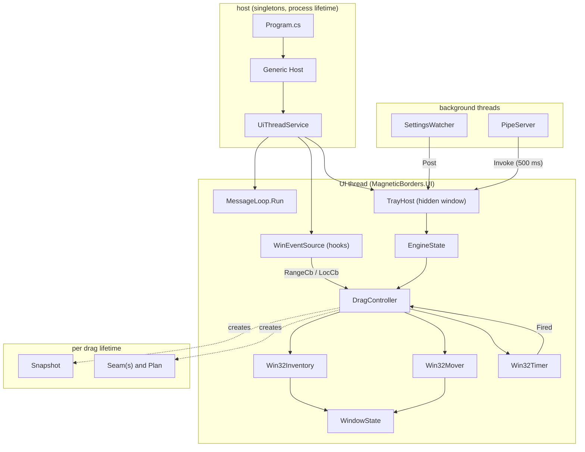

# C# build reference

This page explains every type in `src/engines/dotnet/` so the code can be read file by file. Behavior is defined in the [specs](../../spec/index.md). This page only describes how the C# code implements it.

## Project map

| Folder | Project | Layer | Depends on |
|---|---|---|---|
| `src/engines/dotnet/core/` | `MagneticBorders.Core` | Domain: rectangles, seams, the glue algorithm, the attraction algorithm | nothing |
| `src/engines/dotnet/app/` | `MagneticBorders.Application` | Application: drag controller, ports, settings, pipe protocol | `core` |
| `src/engines/dotnet/win32/` | `MagneticBorders.Win32` | Adapters: WinEvent hooks, mouse hook, window enumeration, `DeferWindowPos`, tray, pipe server | `app`, `core` |
| `src/engines/dotnet/host/` | `MagneticBorders.Host` | Composition root, produces `MagneticBorders.Net.exe` | all of the above |
| `src/engines/dotnet/fixture-runner/` | `FixtureRunner` | Console tool that runs `tests/fixtures/*.layout` against `core` | `core` |
| `src/engines/dotnet/tests/` | `MagneticBorders.Core.Tests`, `MagneticBorders.Application.Tests` | xUnit tests for `core` (including all fixtures) and `app` (fake ports) | `core`, `app`, `FixtureRunner` |

Dependencies point inward: `host` to `win32` to `app` to `core`. Win32 types never appear in `core` or `app`. Only `host` knows concrete types.

## Types by project

### core

| Type | Kind | File | Purpose | Collaborators |
|---|---|---|---|---|
| `Edge` | enum | `core/Geometry.cs` | Left, Top, Right, or Bottom side of a rectangle | `EdgeExt`, `Seam` |
| `Rect` | readonly record struct | `core/Geometry.cs` | Pixel rectangle, R and B exclusive | everything |
| `WinInfo` | readonly record struct | `core/Geometry.cs` | One window in a snapshot: id, visual frame, minimum size | `SeamBuilder`, `Snapshot` |
| `Config` | readonly record struct | `core/Geometry.cs` | Glue tolerance in pixels for one build | `SeamBuilder`, `DragController` |
| `EdgeExt` | static class | `core/Geometry.cs` | `IsVertical`, `Opposite`, `Coord`, `With` helpers | `SeamBuilder`, `DragController` |
| `Side` | enum | `core/Seam.cs` | Whether a member's same or opposite edge lies on the seam | `SeamMember` |
| `SeamMember` | record | `core/Seam.cs` | A glued window with its offset `D` from the seam line | `Seam`, `SeamBuilder` |
| `Seam` | record | `core/Seam.cs` | The line plus its members | `DragController` |
| `Plan` | record | `core/Seam.cs` | New member frames and the clamped seam position | `DragController` |
| `SeamBuilder` | static class | `core/SeamBuilder.cs` | `Build` finds glued windows, `Propagate` moves them with minimum-size clamping | `DragController`, `Fixture` |
| `Point` | readonly record struct | `core/Geometry.cs` | Screen point, for example the cursor | `PointerDrag`, `IPointerHook` |
| `TargetKind`, `ReleaseReason` | enums | `core/Attraction.cs` | What a held edge is held on, and why it was let go | `Attraction`, `DragController` |
| `AttractionConfig` | sealed record | `core/Attraction.cs` | Pull-in, breakaway, and speed limit in physical pixels, and the two target switches | `Attraction`, `DragController` |
| `SideTargets` | sealed record | `core/Attraction.cs` | Which work-area sides are targets. `For` drops a side that touches another monitor. | `Attraction`, `DragController` |
| `EdgeSpan` | readonly record struct | `core/Attraction.cs` | Half-open span along an edge | `TargetWindow` |
| `TargetWindow` | sealed record | `core/Attraction.cs` | Another window's frame and the visible spans of each edge. `Create` cuts out the parts that windows above it cover. | `Attraction`, `DragController` |
| `AttractionEvent` | readonly record struct | `core/Attraction.cs` | One engage or release, for the log | `DragController` |
| `Attraction` | sealed class | `core/Attraction.cs` | Per-drag state: turns each free position into the held position, with speed, sliding, breakaway, and blocked lines | `PointerDrag`, `DragController` |
| `PointerDrag` | sealed class | `core/PointerDrag.cs` | Runs an `Attraction` from mouse movement and returns where the cursor must go | `DragController` |

### app

| Type | Kind | File | Purpose | Collaborators |
|---|---|---|---|---|
| `DragState` | enum | `app/DragController.cs` | Idle, Classifying, Resizing, Moving, Ignoring | `DragController`, `WinEventSource` |
| `SnapOptions` | sealed record | `app/DragController.cs` | Attraction tunables in effective pixels | `DragController`, `EngineState` |
| `DragController` | sealed class | `app/DragController.cs` | State machine for one drag: a resize drives `SeamBuilder`, a move drives `Attraction` | all ports, `SeamBuilder`, `Attraction`, `EngineState` |
| `EngineState` | sealed class | `app/EngineState.cs` | Applies settings, builds the status reply, executes pipe commands | `DragController`, `PipeProtocol`, `TrayHost` |
| `PipeAction` | enum | `app/PipeProtocol.cs` | Side effect a command requests: `None`, `Reload`, or `Quit` | `PipeProtocol`, `EngineState` |
| `StatusSnapshot` | record | `app/PipeProtocol.cs` | Values for the status reply | `EngineState` |
| `PipeResult` | readonly record struct | `app/PipeProtocol.cs` | Reply line plus action | `EngineState` |
| `PipeProtocol` | static class | `app/PipeProtocol.cs` | Pure request line to reply line logic | `EngineState`, `PipeServer` |
| `Snapshot` | record | `app/Ports.cs` | Windows, work area, DPI scale, every monitor's work area, and the z-order stack at drag start | `IWindowInventory`, `DragController` |
| `IWindowInventory` | interface | `app/Ports.cs` | Port: snapshot and frame reads | `Win32Inventory` |
| `IWindowMover` | interface | `app/Ports.cs` | Port: batched window moves | `Win32Mover` |
| `IPointerHook` | interface | `app/Ports.cs` | Port: installs and removes the mouse hook that holds the cursor during a move | `Win32PointerHook` |
| `IPointerEvents` | interface | `app/Ports.cs` | Sink for mouse movement and button releases, implemented by `DragController` | `Win32PointerHook` |
| `IClock` | interface | `app/Ports.cs` | Port: millisecond clock | `StopwatchClock` |
| `ILog` | interface | `app/Ports.cs` | Port: log sink | `EngineLog` |
| `TimerKind` | enum | `app/Ports.cs` | Flush, Settle, Verify | `ITimer`, `DragController` |
| `ITimer` | interface | `app/Ports.cs` | Port: one-shot UI-thread timers | `Win32Timer` |
| `EngineInfo` | static class | `app/Settings.cs` | Build name constant | `Paths`, `EngineState` |
| `IAppInfo` | interface | `app/Settings.cs` | Version source | `AppInfo`, `EngineState` |
| `AppInfo` | sealed class | `app/Settings.cs` | `FromAssembly` and `FromEntryAssembly` read the informational version and strip `+metadata` | `Program` |
| `SettingsModel` | sealed record | `app/Settings.cs` | In-memory form of `settings.json` | `SettingsParser`, `EngineState` |
| `SettingsParser` | static class | `app/Settings.cs` | `JsonDocument` based parser with defaults and clamping (`TryParse`). `TryWithEnabled` sets the top-level `enabled` key and keeps every other key. | `SettingsStore` |

### win32

| Type | Kind | File | Purpose | Collaborators |
|---|---|---|---|---|
| `Frames` | internal static class | `win32/Frames.cs` | DWM frame and `GetWindowRect` reads, id to `HWND` | `Win32Inventory`, `Win32Mover` |
| `MessageLoop` | static class | `win32/MessageLoop.cs` | `GetMessage` loop, `PostQuit`, drag-contents check | `UiThreadService`, `Program` |
| `Paths` | static class | `win32/Services.cs` | Data, settings, and log paths | `SettingsStore`, `EngineLog` |
| `Autostart` | static class | `win32/Services.cs` | HKCU Run key | `EngineState` |
| `Native` | static class | `win32/Services.cs` | Console and message box | `Program` |
| `SettingsWatcher` | sealed class | `win32/Services.cs` | `FileSystemWatcher` on `settings.json` (background thread) | `TrayHost` |
| `PipeServer` | sealed class | `win32/Services.cs` | Named pipe accept loop (pipe thread) | `TrayHost.Invoke`, `PipeProtocol` |
| `PipeClient` | static class | `win32/Services.cs` | One-shot client used by a second instance | `Program` |
| `TrayHost` | sealed class | `win32/Tray.cs` | Hidden message window, notification area icon, menu with a checkable **Enabled** item, posted-action queue | `EngineState`, `SettingsApp` |
| `SettingsApp` | static class | `win32/Tray.cs` | Finds and launches the settings app | `TrayHost` |
| `WindowState` | sealed class | `win32/WindowState.cs` | Frame offsets and excluded windows shared by inventory and mover | `Win32Inventory`, `Win32Mover` |
| `Win32Inventory` | sealed class | `win32/Win32Inventory.cs` | `IWindowInventory` via `EnumWindows`, `EnumDisplayMonitors`, and filters | `WindowState`, `Frames` |
| `Win32PointerHook` | sealed class | `win32/Win32PointerHook.cs` | `IPointerHook` via a `WH_MOUSE_LL` hook that exists only during a move | `DragController` |
| `Win32Mover` | sealed class | `win32/Win32Mover.cs` | `IWindowMover` via `DeferWindowPos` | `WindowState`, `Frames` |
| `Win32Timer` | sealed class | `win32/Win32Timer.cs` | `ITimer` via `SetTimer` with a null `HWND` | `DragController` |
| `WinEventSource` | sealed class | `win32/WinEventSource.cs` | WinEvent hooks that feed the controller | `DragController` |

### host

| Type | Kind | File | Purpose | Collaborators |
|---|---|---|---|---|
| top-level statements | n/a | `host/Program.cs` | Single-instance mutex, DI registrations, `host.RunAsync()` | everything |
| `EngineLog` | internal sealed class | `host/Adapters.cs` | `ILog` to a file (1 MB truncation) and optional console | `Paths` |
| `StopwatchClock` | internal sealed class | `host/Adapters.cs` | `IClock` on `Environment.TickCount64` | `DragController` |
| `SettingsStore` | internal static class | `host/Adapters.cs` | `Load` reads `settings.json` with retries. `ToggleEnabled` flips the saved `enabled` key through a temp file. | `SettingsParser`, `UiThreadService` |
| `UiThreadService` | internal sealed class | `host/UiThreadService.cs` | Hosted service that owns the UI thread | `TrayHost`, `WinEventSource`, `EngineState` |

### fixture-runner

| Type | Kind | File | Purpose | Collaborators |
|---|---|---|---|---|
| `Fixture` | sealed class | `fixture-runner/Fixture.cs` | Parses a `.layout` file, runs `SeamBuilder`, compares expectations | `SeamBuilder` |
| top-level statements | n/a | `fixture-runner/Program.cs` | CLI: `[--print] <file-or-dir>`, exit code 1 on any failure | `Fixture` |

## How DI and the Generic Host wire it together

`host/Program.cs` builds the host with `Host.CreateEmptyApplicationBuilder` and `DisableDefaults = true`. That skips configuration files, environment variables, default logging, and anything else that would pull in reflection. Everything is registered by hand:

- `ILog`, `IAppInfo`: pre-built instances, because they are needed before the host exists (to log the version and check the drag setting).
- `Win32Timer` plus `ITimer` forwarding to it, `IClock`, `WindowState`.
- `Win32Inventory` plus `IWindowInventory` forwarding to it, and `IWindowMover`.
- `Win32PointerHook`, assigned to `DragController.Hook`.
- `DragController`: a factory lambda that also assigns `Win32Timer.Fired = controller.OnTimer`. This closes the loop between the port and the controller without a circular constructor dependency.
- `EngineState`: a factory that passes `Win32Inventory.SetExcluded` and `Autostart.Set` as callbacks.
- `WinEventSource`.
- `UiThreadService` as the one hosted service.

All registrations are singletons, because there is exactly one of each thing in the background process.

`UiThreadService.StartAsync` starts a thread named `MagneticBorders.UI` and blocks until setup finishes, so a failure (for example hook installation) fails host startup. On that thread it creates `TrayHost`, wire `EngineState` events, load settings, install the hooks, start the settings watcher and pipe server, and then run `MessageLoop.Run()`. When the loop ends (notification area menu Exit, pipe `quit`, or `StopAsync` posting `WM_QUIT`), the `finally` block disposes everything in reverse order and calls `IHostApplicationLifetime.StopApplication()`.

### Compared with a WPF app using MVVM and IoC

- There is no XAML, view, or view model. The "UI" is a message loop and a notification area icon, so there is nothing to bind and no `INotifyPropertyChanged`.
- The ports (`IWindowInventory`, `IWindowMover`, `ITimer`, `IClock`, `ILog`) play the role that services play behind view models. `DragController` is the view model equivalent: a plain class with no framework types, tested with fakes.
- `UiThreadService` plays the role of the WPF `Dispatcher` thread. `TrayHost.Post` is like `Dispatcher.BeginInvoke` and `TrayHost.Invoke` is like `Dispatcher.Invoke` with a timeout.
- The container is the same `Microsoft.Extensions.DependencyInjection`, but registration is explicit instead of scanning assemblies, and factory lambdas replace instead of reflection-based activation.
- The composition root is `Program.cs`, like `App.xaml.cs` or a `ConfigureServices` method.

## Follow one drag through the code

1. `host/Program.cs` runs `WinEventSource.Install()` on the UI thread (through `UiThreadService.Run`). It registers a range hook for `EVENT_SYSTEM_MOVESIZESTART` to `EVENT_SYSTEM_MOVESIZEEND` with `WINEVENT_OUTOFCONTEXT`.
2. The user grabs a window border. Windows posts the event, and the message loop in `MessageLoop.Run` calls the `[UnmanagedCallersOnly]` static `WinEventSource.RangeCb`. It reads the static `s_slot` and calls `OnRange`.
3. `OnRange` on start calls `DragController.OnMoveSizeStart(id)`. The controller cancels timers, calls `IWindowInventory.Snapshot`, and enters `Classifying`. If it entered `Ignoring`, `OnRange` ends the drag at once. Otherwise `OnRange` installs a second hook for `EVENT_OBJECT_LOCATIONCHANGE`, filtered to the dragged window's process.
4. `Win32Inventory.Snapshot` finds the monitor, work area, and DPI scale, runs `EnumWindows` with the `EnumCb` function pointer, filters with `Eligible`, and stores each window's `GetWindowRect` minus visual frame offset in `WindowState.Offsets`. It also collects every monitor's work area (`EnumDisplayMonitors`) and the z-order of the windows that hide what is below them.
5. Each location change calls the static `LocCb`, then `OnLoc`, then `DragController.OnLocationChange`. In `Classifying` the controller compares the frame with the start frame. A move (same size) becomes `Moving` when magnetic attraction is on, and `Ignoring` otherwise. A resize picks the changed edges and calls `SeamBuilder.Build` for each. No seam means `Ignoring`; otherwise the state becomes `Resizing`.
6. `ApplyFrame` calls `SeamBuilder.Propagate` for every seam and merges the moves. If the last batch was less than 8 ms ago, it stores the frame as pending and arms the `Flush` timer. Otherwise it calls `IWindowMover.Apply`.
7. `Win32Mover.Apply` adds the cached offsets back, then calls `BeginDeferWindowPos`, `DeferWindowPos` for each window, and `EndDeferWindowPos`. If that fails it falls back to `SetWindowPos` and excludes windows that still fail. It returns the frames read back, and `ApplyFrame` records any minimum size a window refused to go below in `_learned`.
8. After every location change, `Win32Timer.Arm(Settle, 150)` replaces the previous timer. If the drag pauses, `Win32Timer.Cb` fires, `OnFire` raises `Fired`, and `DragController.OnTimer(Settle)` runs `Settle`, which learns minimums and re-applies if needed.
9. On release, `RangeCb` runs again with the end event. `OnRange` removes the location hook and calls `OnMoveSizeEnd`. The controller applies the final frame, snaps the dragged window back to the clamped position if it overshot, sets `_verifyArmed`, and arms the `Verify` timer for 60 ms.
10. A move takes another path. `BeginMove` builds an `Attraction` from the snapshot and, when `Hook` is set, `StartPointer` installs the `WH_MOUSE_LL` hook and hands the attraction to a `PointerDrag`. `Win32PointerHook.MouseCb` then calls `OnPointerMove` for every mouse movement. A non-null result blocks the movement and `SetCursorPos` puts the cursor there, so Windows moves the window onto its held position. A button release calls `OnPointerRelease`, which removes the hook. Without the hook, `OnMove` feeds each location change to the `Attraction` and moves the window back to the held position. `OnMoveSizeEnd` stops the hook, or applies the held position once in the fallback case.
11. `Verify` re-reads every requested frame and the dragged window. If anything differs it sends one corrective batch through `IWindowMover.Apply`, logs the result, and clears the seams. The state is already `Idle`.

## Settings and pipe

**Settings.** `SettingsWatcher` runs a `FileSystemWatcher` on `settings.json`. Its events arrive on a thread-pool thread, so the callback only calls `TrayHost.Post(DebounceReload)`. That enqueues an action on a `ConcurrentQueue` and posts `WM_RUN` to the hidden window. On the UI thread `DebounceReload` starts a 100 ms `SetTimer`. Editors often write a file in several steps, and the timer collapses them. When it fires, `TrayHost` calls the `Reload` local function in `UiThreadService`, which calls `SettingsStore.Load` and then `EngineState.Apply`. `Load` retries three times on `IOException` and returns null when the JSON is invalid, so the previous settings stay in force. `Apply` pushes the coupling tolerance and active flag and the attraction options and active flag to `DragController`, the excluded apps to `Win32Inventory`, the autostart choice to `Autostart.Set`, and raises `Changed` so the notification area icon tooltip refreshes.

**Pipe.** `PipeServer` listens on `\\.\pipe\MagneticBorders` from its own thread and serves each client in a task with a 2 second limit. Each request is one JSON line. The handler the host passes is `line => tray.Invoke(() => state.Handle(line), 500)`. `Invoke` posts the work to the UI thread and waits at most 500 ms, so application state is never touched from the pipe thread. On timeout the client gets `{"ok":false,"error":"timeout"}`. `EngineState.Handle` calls the pure `PipeProtocol.Handle`, runs the requested `PipeAction` (`Reload` or `Quit`) and returns the reply. `Quit` goes through `TrayHost.QuitSoon`, a 150 ms timer, so the reply can flush before the loop exits. A second instance uses `PipeClient.Request` to send `status` before it shows its "already running" message.

**Notification area menu and the Enabled switch.** `UiThreadService` creates `TrayHost` with `() => state.Settings.Enabled` and `() => SettingsStore.ToggleEnabled(log)`. `TrayHost.ShowMenu` builds a header, a checkable **Enabled** item (`IdEnabled`, checked when the saved switch is on), **Settings** (`IdSettings`), and **Exit** (`IdExit`). Choosing Enabled calls `SettingsStore.ToggleEnabled`. It reads the file, calls `SettingsParser.TryWithEnabled`, and writes the result through a temp file. `SettingsWatcher` then reloads it like any other edit, so the tray, the flyout, and the settings window all flip the same saved `enabled` key. The tooltip adds "disabled" when it is off. There is no pause.

## Diagram

Everything in the first two boxes lives for the whole process. `Snapshot` and `Seam` objects are created at drag start and dropped after `Verify`. `_learned` inside `DragController` is the one piece of drag data that survives between drags.

## Native AOT notes

- **No reflection.** DI uses explicit `AddSingleton` calls and factory lambdas. There is no assembly scanning, no `IOptions` binding, and no default host configuration.
- **No serializer.** `SettingsParser` reads with `JsonDocument`. `PipeProtocol.Status` builds the reply with string interpolation. There is no `JsonSerializer`, so no source generator is needed and nothing can be trimmed away.
- **Function pointers instead of delegates.** WinEvent hooks, `EnumWindows`, `SetTimer`, and the tray window procedure are `[UnmanagedCallersOnly(CallConvs = [typeof(CallConvStdcall)])]` static methods passed as `&Method`. Because a static method has no instance, each class keeps one `static` slot (`s_slot`) that points at the live object. This is safe because there is one UI thread and one instance of each.
- **CsWin32.** `PInvoke` calls are generated at compile time as `LibraryImport`-style P/Invokes, which AOT handles. Struct fields such as `NOTIFYICONDATAW.szTip` are written through pointers.
- **Version lookup.** `AppInfo.FromAssembly` reads `AssemblyInformationalVersionAttribute` directly, which is AOT-safe.
- **Warnings.** The rule is zero IL2xxx and IL3xxx warnings. Do not add `Activator`, `Type.GetType`, `Enum.GetValues` on non-generic types, or serializer calls without checking the publish output.

## Where to change things

| To change... | Edit |
|---|---|
| How neighbors are found or clamped | `core/SeamBuilder.cs`, then add a `.layout` in `tests/fixtures/` and change the other two builds too |
| How edges snap, slide, and break away | `core/Attraction.cs` and `core/PointerDrag.cs`, then the other two builds |
| Which edges count as resized, throttle, settle, and verify timing, and the move path | `app/DragController.cs` |
| Which windows are eligible | `Win32Inventory.Eligible` in `win32/Win32Inventory.cs` |
| How windows are moved | `win32/Win32Mover.cs` |
| A new setting | `SettingsModel` and `SettingsParser` in `app/Settings.cs`, then `EngineState.Apply`, and update `docs/spec/contract.md` |
| A new pipe command | `PipeAction` and `PipeProtocol.Handle` in `app/PipeProtocol.cs`, then `EngineState.Handle` |
| Notification area menu or click behavior | `win32/Tray.cs` (`ShowMenu`), `SettingsStore.ToggleEnabled` in `host/Adapters.cs` |
| Hook registration | `win32/WinEventSource.cs` and, for the mouse hook, `win32/Win32PointerHook.cs` |
| DI registrations or startup order | `host/Program.cs` and `host/UiThreadService.cs` |
| Log format or location | `host/Adapters.cs` and `win32/Services.cs` (`Paths`) |
| Fixture file format | `fixture-runner/Fixture.cs` |
| A new port | interface in `app/Ports.cs`, adapter in `win32/`, registration in `host/Program.cs`, fake in `tests/app/` |

## Tests and quality

Every step runs through `pwsh tools/ci/run.ps1 -Target dotnet -Steps lint,build,test,coverage`. The local build watcher and the GitHub workflows call the same script. The step definitions are in `tools/ci/targets/dotnet.ps1`.

- **Test framework.** xUnit with `Microsoft.NET.Test.Sdk` and `coverlet.collector`. Package versions are pinned in `Directory.Packages.props`.
- **Where tests live.** `tests/core/` holds `MagneticBorders.Core.Tests` (`GeometryTests`, `SeamBuilderTests`, `SeamTests`, `AttractionTests`, `PointerDragTests`, and `FixtureTests`, which runs every shared `.layout` file). `tests/app/` holds `MagneticBorders.Application.Tests`: the `DragControllerTests`, `DragControllerBehaviorTests`, and `AttractionControllerTests` classes with fake ports (`FakeInventory`, `SnapInventory`, `FakeMover`, `FakeClock`, `FakeTimer`, `FakeHook`, `NullLog`, `RecordingLog`), `SettingsParserTests`, `PipeProtocolTests`, `EngineStateTests`, and `AppInfoTests`. The `win32` and `host` projects have no unit tests. They are covered by running the app.
- **Coverage.** `coverage.runsettings` selects the Cobertura format and excludes tests, `fixture-runner`, generated code, and anything marked `ExcludeFromCodeCoverage`. The step merges the reports into `artifacts/coverage/dotnet.cobertura.xml` and fails below 40 percent line coverage.
- **Lint.** `dotnet format MagneticBorders.slnx --verify-no-changes --severity error`, then a full `dotnet build` with `-warnaserror`. `Directory.Build.props` sets `AnalysisLevel` to `latest-recommended`, turns on `EnforceCodeStyleInBuild`, and `TreatWarningsAsErrors`. The C# build `.editorconfig` raises file-scoped namespaces, unused usings, and read-only fields to warnings. The test `.editorconfig` turns off `CA1707` so test names can use underscores. On top of that, the Native AOT rule stays: no IL2xxx or IL3xxx warnings.
- **Deterministic builds.** `Deterministic` is on, packages use `packages.lock.json` files, and the pinned SDK is in `global.json`. With `-Ci` the script sets `ContinuousIntegrationBuild`, restores with `--locked-mode`, and maps paths to `/_/`.
- **Architectures.** The host project restores `win-x64` and `win-arm64`. x64 builds, tests, and publishes natively. ARM64 builds and publishes the host with `-r win-arm64` and is not tested.
