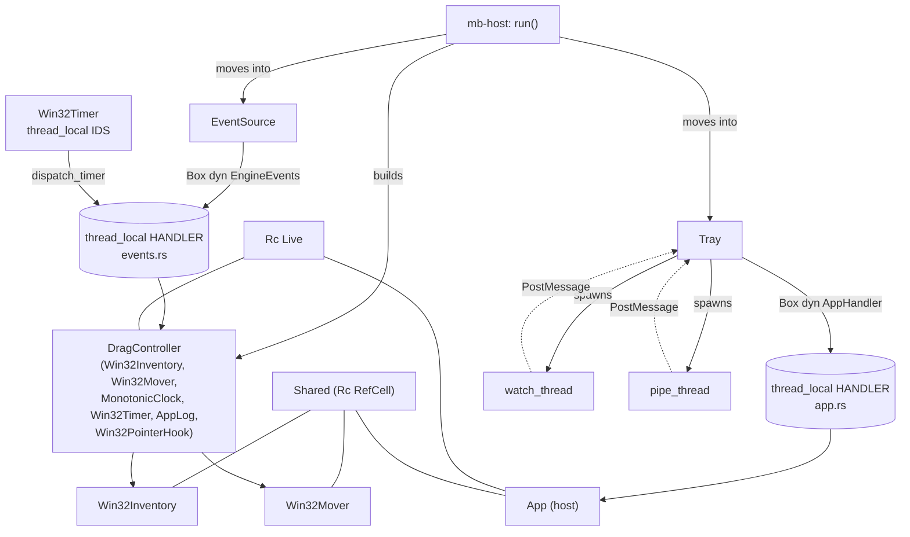

# Rust build reference

This page lists every type in `src/engines/rust/` so the code is easy to navigate. Behavior is defined in the [specs](../../spec/index.md). This page only describes how the Rust code is organized.

## Crate map

| Folder | Crate | Layer |
|---|---|---|
| `src/engines/rust/core` | `mb-core` | Domain. Pure geometry, the seam algorithm, and magnetic attraction. |
| `src/engines/rust/app` | `mb-app` | Application. Port traits, `DragController`, settings, pipe protocol. |
| `src/engines/rust/win32` | `mb-win32` | Win32 adapters. Windows only (`cfg(windows)`). |
| `src/engines/rust/host` | `mb-host` | Host. The `magnetic-borders-rs` binary and composition root. |
| `src/engines/rust/fixture-runner` | `mb-fixtures` | Test tooling. `fixture-runner` binary and the fixture integration test. |

Win32 types stay out of `mb-core` and `mb-app`. That is why the controller can be tested with fake ports.

## Types per crate

### mb-core

| Type | Kind | File | Purpose | Collaborators |
|---|---|---|---|---|
| `Rect` | struct | `core/src/geom.rs` | Physical-pixel rectangle, right, and bottom exclusive. | `Edge`, `WinInfo` |
| `Point` | struct | `core/src/geom.rs` | Physical-pixel point, used for cursor positions. | `PointerDrag`, `PointerHook` |
| `Edge` | enum | `core/src/geom.rs` | Left, Top, Right, Bottom side of a rect. | `Rect`, `Seam` |
| `WinInfo` | struct | `core/src/geom.rs` | One eligible window: id, frame, minimum size. | `build_seam`, `Snapshot` |
| `Config` | struct | `core/src/geom.rs` | Glue tolerance for seam detection. | `build_seam` |
| `Side` | enum | `core/src/seam.rs` | Which edge of a member sits on the seam (same or opposite). | `Member` |
| `Member` | struct | `core/src/seam.rs` | A window glued to the dragged edge, with its signed offset `d`. | `Seam` |
| `Seam` | struct | `core/src/seam.rs` | The edge, its position, and the members that move with it. | `build_seam`, `propagate` |
| `Plan` | struct | `core/src/seam.rs` | New member frames and the clamped seam position. | `propagate`, `DragController` |
| `build_seam` | fn | `core/src/seam.rs` | Finds members glued to a dragged edge, chained along the seam. | `Config`, `WinInfo` |
| `propagate` | fn | `core/src/seam.rs` | Computes member frames for a seam position, clamped to minimum sizes. | `Seam`, `Plan` |
| `Attraction` | struct | `core/src/attraction.rs` | Per-drag state of magnetic attraction: takes free positions, returns held positions, tracks speed, holds, releases, and blocked lines. | `AttractionConfig`, `TargetWindow`, `SideTargets` |
| `AttractionConfig`, `SideTargets` | structs | `core/src/attraction.rs` | Distances and switches scaled to physical pixels; which work-area sides are targets. | `Attraction` |
| `TargetWindow`, `Span`, `make_target` | struct, struct, fn | `core/src/attraction.rs` | Another window with the visible spans of each edge (SNAP-038). | `Attraction` |
| `AttractionEvent`, `TargetKind`, `ReleaseReason` | struct, enums | `core/src/attraction.rs` | One engage or release, for the log (SNAP-060). | `Attraction`, `DragController` |
| `screen_side_targets` | fn | `core/src/attraction.rs` | Drops work-area sides that touch another monitor (SNAP-031). | `SideTargets` |
| `PointerDrag` | struct | `core/src/pointer_drag.rs` | Runs an `Attraction` from mouse movement and returns where the cursor must go (SNAP-070 to SNAP-074). `calibrate` corrects its grab-offset estimate while an axis is held (SNAP-077). | `Attraction`, `Point` |

### mb-app

| Type | Kind | File | Purpose | Collaborators |
|---|---|---|---|---|
| `DragController` | struct | `app/src/controller.rs` | Generic drag state machine; the brain of the build. | all port traits, `Live` |
| `State`, `Drag`, `Resize`, `Moving`, `Mode`, `Verify` | private enum and structs | `app/src/controller.rs` | Idle, Classifying, Resizing, Moving, Ignoring states, the move drag (`Mode::Pointer` holds the cursor, `Mode::Frame` moves the window back) and the post-drag verify record. | `DragController` |
| `Live` | struct | `app/src/live.rs` | Shared `Cell` knobs (`active`, `tolerance_px`, `snap_active`, `snap`) and the `drags`, `glued_drags`, `move_drags`, and `snaps` counters. | host `App`, `DragController` |
| `SnapOptions` | struct | `app/src/live.rs` | Magnetic attraction tunables in 96-dpi pixels, scaled per drag. | `Live`, `Settings` |
| `Snapshot` | struct | `app/src/ports.rs` | Windows, work area, every monitor's work area, the z-order stack, and dpi scale. | `WindowInventory` |
| `WindowInventory` | trait | `app/src/ports.rs` | Port: snapshot and current frame lookup. | `Win32Inventory` |
| `WindowMover` | trait | `app/src/ports.rs` | Port: apply a batch of moves, return read-back frames. | `Win32Mover` |
| `Clock` | trait | `app/src/ports.rs` | Port: monotonic milliseconds. | `MonotonicClock` |
| `Timer`, `TimerKind` | trait, enum | `app/src/ports.rs` | Port: one-shot Flush, Settle, and Verify timers. | `Win32Timer` |
| `Log` | trait | `app/src/ports.rs` | Port: info and debug lines. | `AppLog`, `ConsoleLog` |
| `DragEvents` | trait | `app/src/ports.rs` | Inbound port: start, location change, end, timer. | `EventSource`, `Win32Timer` |
| `PointerEvents` | trait | `app/src/ports.rs` | Inbound port: mouse movement and button release during a move. | `Win32PointerHook` |
| `EngineEvents` | trait | `app/src/ports.rs` | `DragEvents` plus `PointerEvents`; what the event adapters hold. | `EventSource` |
| `PointerHook` | trait | `app/src/ports.rs` | Port: start and stop the mouse hook, read the cursor. | `Win32PointerHook` |
| `Settings` | struct | `app/src/settings.rs` | Schema 1 settings model with lenient parsing (`Settings::parse`). | `apply_reload`, host `App` |
| `apply_reload` | fn | `app/src/settings.rs` | Reload rule: keep previous settings on error, defaults when missing. | `Settings` |
| `with_enabled` | fn | `app/src/settings.rs` | Returns the settings text with the top-level `enabled` key set and every other key kept, in order. Errors on a non-object, so the host never overwrites a file it cannot read. | host `App::toggle_enabled` |
| `EngineState` | struct | `app/src/pipe.rs` | Snapshot reported by the `status` command. | `handle_request` |
| `Action` | enum | `app/src/pipe.rs` | Side effect after a reply: `None`, `Reload`, or `Quit`. | `Reply` |
| `Reply` | struct | `app/src/pipe.rs` | Response line plus action. | `AppHandler::on_pipe` |
| `handle_request` | fn | `app/src/pipe.rs` | Parses one request line and builds the reply. | `EngineState`, `Reply` |
| `VERSION` | const | `app/src/lib.rs` | Build version from `CARGO_PKG_VERSION`. | host, pipe |

### mb-win32

| Type | Kind | File | Purpose | Collaborators |
|---|---|---|---|---|
| `EventSource` | struct | `win32/src/events.rs` | Installs the WinEvent hooks; owns the `HANDLER` thread-local slot. | `EngineEvents` |
| `Win32Inventory` | struct | `win32/src/inventory.rs` | `WindowInventory` via EnumWindows, DWM, and monitor APIs, including the z-order stack and every monitor's work area. | `Shared` |
| `Win32PointerHook` | struct | `win32/src/pointer.rs` | `PointerHook` via a `WH_MOUSE_LL` hook that exists only during a move. | `events::with_engine` |
| `Win32Mover` | struct | `win32/src/mover.rs` | `WindowMover` via DeferWindowPos with SetWindowPos fallback. | `Shared` |
| `Win32Timer` | struct | `win32/src/timer.rs` | `Timer` via SetTimer, slots kept in a thread-local. | `events::dispatch_timer` |
| `Shared` | struct | `win32/src/util.rs` | Frame offsets, banned windows, and excluded exe names. | inventory, mover, host |
| `AppHandler` | trait | `win32/src/app.rs` | Application behavior behind tray, watcher, and pipe: `on_settings_changed`, `on_pipe`, `is_enabled`, `toggle_enabled`. | `Tray`, host `App` |
| `AppInfo` | struct | `win32/src/app.rs` | Tray title, version, and data folder. | `Tray` |
| `Tray` | struct | `win32/src/app.rs` | Hidden window, notification area icon and menu, settings watcher thread, pipe thread. | `AppHandler` |
| `pipe_request` | fn | `win32/src/app.rs` | Client side: sends one line to a running copy of Magnetic Borders. | `PIPE_NAME` |
| `MonotonicClock` | struct | `win32/src/misc.rs` | `Clock` over `Instant`. | `DragController` |
| `ConsoleLog`, `AppLog` | structs | `win32/src/misc.rs` | `Log` implementations: stdout and a size-capped file with optional console mirror. | host |
| `SingleInstance` | struct | `win32/src/misc.rs` | Named mutex guard. | host |
| `Win32Error` | enum | `win32/src/lib.rs` | Wraps `windows::core::Error` (thiserror). | `EventSource`, `Tray` |
| misc functions | fns | `win32/src/misc.rs` | `run_message_loop`, `set_dpi_awareness`, `alloc_console`, `message_box`, `set_run_at_login`, `drag_full_windows_enabled`. | host |

### mb-host

| Type | Kind | File | Purpose | Collaborators |
|---|---|---|---|---|
| `App` | struct (private) | `host/src/main.rs` | Implements `AppHandler`: settings reload, the Enabled toggle, pipe commands. | `Live`, `Shared`, `AppLog` |
| `run` | fn | `host/src/main.rs` | Composition root: builds adapters, controller, hooks, tray, message loop. | everything |
| `write_atomic` | fn | `host/src/main.rs` | Writes a temp file next to `settings.json`, then replaces the original. | `App::toggle_enabled` |
| `engine_label` | fn | `host/src/main.rs` | Names the build for the "already running" message. | `run` |

The host builds `Win32PointerHook` and gives it to the controller with `with_pointer_hook`.

The file `host/src/settings.rs` is an empty placeholder outside the module tree. Settings live in `mb-app`.

### mb-fixtures

| Type | Kind | File | Purpose | Collaborators |
|---|---|---|---|---|
| `Fixture` | struct | `fixture-runner/src/lib.rs` | One parsed `.layout` case; `parse`, `run`, `check`, `print`. | `build_seam`, `propagate` |
| `FixtureError` | enum | `fixture-runner/src/lib.rs` | Parse, io, and mismatch errors (thiserror). | `Fixture` |
| `load`, `collect` | fns | `fixture-runner/src/lib.rs` | Read one fixture; list `.layout` files under a path. | `Fixture` |

## Follow one drag through the code

This section traces one resize from the first WinEvent to the Verify timer. Every step runs on the UI thread.

1. `move_size_proc` (`win32/src/events.rs`) receives `EVENT_MOVESIZESTART`. It stores the window in `DRAGGED`, installs a `LOCATIONCHANGE` hook limited to that process, and calls `with_handler`.
2. `DragController::on_move_size_start` reads the dragged window's frame and the cursor as the pointer reference (SNAP-071), cancels timers, checks `Live.active`, and calls `Win32Inventory::snapshot`. That runs `EnumWindows` with `enum_cb` and `eligible`, and records each window's frame offset in `Shared`. The state becomes `Classifying`.
3. `loc_proc` fires for every location change of the dragged window and calls `DragController::on_location_change`.
4. `DragController::classify` hands a move (same size) to `begin_move` when magnetic attraction is on, and ignores it otherwise. For a resize with magnetic coupling on, for each changed edge it calls `mb_core::build_seam`. No seam means `Ignoring`. Otherwise the state becomes `Resizing`.
5. `on_location_change` throttles to 8 ms. When it is due, `do_apply` calls `apply_plan`, which calls `plan_all`, which calls `mb_core::propagate` for each seam.
6. `Win32Mover::apply` filters banned and hung windows, converts frames to window rects with `window_rect`, then `batch` runs `BeginDeferWindowPos`, `DeferWindowPos` per member, and `EndDeferWindowPos`. It reads back the real frames.
7. `DragController::learn` raises a member's minimum size when the window refused to shrink.
8. Otherwise the controller arms `TimerKind::Flush` through `Win32Timer::arm` (`SetTimer`). It always re-arms `TimerKind::Settle` (150 ms).
9. `timer_proc` (`win32/src/timer.rs`) calls `events::dispatch_timer`, which calls `DragController::on_timer`. Flush runs `do_apply`; Settle runs `on_settle`, which compares sizes with `mismatches` and re-applies when needed.
10. `move_size_proc` receives `EVENT_MOVESIZEEND` and calls `DragController::on_move_size_end`. It applies the final plan, snaps the dragged window back to the clamp when needed, stores a `Verify` record and arms `TimerKind::Verify` (60 ms).
11. `timer_proc` fires again and `DragController::on_verify` checks the dragged window and members. If anything is off, it calls `learn`, `apply_plan`, and `Win32Mover::apply` once more. It then logs `ok` or `fixed`.

## Follow one move through the code

A move (the first location change leaves the size unchanged) runs magnetic attraction instead.

1. `DragController::classify` calls `begin_move`. It scales the `SnapOptions` in `Live` by the dpi, builds a `TargetWindow` for every other window with `make_target` (using `Snapshot.stack` to find the covered parts of each edge), and asks `screen_side_targets` which work-area sides touch another monitor. These feed `mb_core::Attraction::new`.
2. `start_pointer` calls `Win32PointerHook::start`, which installs a `WH_MOUSE_LL` hook. The frame and cursor come from the reference that `on_move_size_start` read before the snapshot (SNAP-071). The attraction moves into a `PointerDrag` and the state becomes `Moving` with `Mode::Pointer`. When there is no hook, it cannot start, or the frame or cursor is unreadable, the state is `Moving` with `Mode::Frame`.
3. `on_mouse` (`win32/src/pointer.rs`) receives every mouse movement. It calls `with_engine`, which reaches `DragController::on_pointer_move` through the same `HANDLER` slot as the drag events. `PointerDrag::move_cursor` returns where the cursor must go. When that differs, the hook calls `SetCursorPos` and swallows the movement, so Windows moves the window to the held position itself.
4. In `Mode::Frame`, `on_location_change` calls `on_move`, which feeds the free position to `Attraction::update` and applies the held position with `Win32Mover::apply`. A frame equal to the last held position is the controller's own move and is skipped.
5. A button release reaches `on_pointer_release`, which stops the hook. `on_move_size_end` stops it too. In `Mode::Frame` it applies the held position once when Windows put the window back at the free position (SNAP-050).

## Settings and pipe walkthrough

**Startup.** `app::run` in `host/src/main.rs` reads `%LOCALAPPDATA%\MagneticBorders\settings.json` and calls `mb_app::apply_reload` with the defaults as the previous value. A missing file gives defaults. A parse or read error keeps the previous value and returns a warning. `Settings::parse` is lenient: wrong types fall back to defaults and values clamp to their range (0 to 64 for the tolerance and the pull-in distance, 0 to 128 for the breakaway distance, 100 to 5000 for the snapping speed).

**Applying.** `App::apply` copies the tolerance, the active flags (`glue_active` and `snap_active`) and the magnetic attraction tunables (`snap_options`) into `Live`, updates `Shared.excluded`, and sets or removes the run-at-login registry value. The controller reads `Live` at every drag, so changes take effect without a restart.

**File changes.** `watch_thread` (`win32/src/app.rs`) waits on `ReadDirectoryChangesW` and posts `WM_SETTINGS` to the hidden window. `wndproc` debounces it with a 100 ms timer, then calls `AppHandler::on_settings_changed`, which is `App::reload`.

**Pipe.** `pipe_thread` serves `\\.\pipe\MagneticBorders`, one client at a time. `serve_one` reads one line, boxes a `PipeReq`, and posts `WM_PIPE` to the hidden window. `wndproc` calls `AppHandler::on_pipe`, which calls `mb_app::handle_request` and then performs the returned `Action`. The reply goes back to the pipe thread through an `mpsc` channel with a 500 ms timeout. `quit` posts `WM_QUIT` after a short delay so the reply reaches the client.

Other threads never touch application state. They only post messages.

**Notification area menu and the Enabled switch.** `Tray` shows the menu from `win32/src/app.rs`: a header, a checkable **Enabled** item (`ID_ENABLED`, checked when `AppHandler::is_enabled` is true), **Settings** (`ID_SETTINGS`), and **Exit** (`ID_EXIT`). Choosing Enabled calls `AppHandler::toggle_enabled`, which is `App::toggle_enabled`. It reads the file with `read_settings`, flips the key with `mb_app::with_enabled`, and saves it with `write_atomic`. The watcher then reloads it like any other edit, so the tray, the flyout, and the settings window all flip the same saved `enabled` key. There is no pause.

## Main objects and ownership

The controller slot in `win32/src/events.rs` is the only route from C callbacks to the controller. `Rc<Live>` and `Shared` are not `Send`, which is how the compiler enforces the single-thread rule.

## Where to change things

| To change | Look in |
|---|---|
| Seam detection or clamping math | `core/src/seam.rs`, then add a `.layout` in `tests/fixtures/` |
| Throttle, settle, or verify timing; drag classification | `app/src/controller.rs` (`THROTTLE_MS`, `SETTLE_MS`, `VERIFY_MS`) |
| A new port | `app/src/ports.rs`, an adapter in `win32/src/`, wiring in `host/src/main.rs` |
| Magnetic attraction geometry (targets, holding, releasing, speed) | `core/src/attraction.rs`, `core/src/pointer_drag.rs` |
| How a move is handled (hook or move back, end of a move) | `app/src/controller.rs` (`begin_move`, `on_move`, `finish_move`, `on_pointer_move`), `win32/src/pointer.rs` |
| Which windows are eligible | `win32/src/inventory.rs` (`eligible`) |
| How windows are moved | `win32/src/mover.rs` |
| Settings keys | `app/src/settings.rs`, `docs/spec/contract.md`, and the other builds |
| Pipe commands | `app/src/pipe.rs` (protocol), `host/src/main.rs` (actions) |
| Notification area menu items | `win32/src/app.rs` (`ID_ENABLED` and friends), `host/src/main.rs` (`toggle_enabled`) |
| Notification area menu, watcher, pipe transport | `win32/src/app.rs` |
| Fixture syntax | `fixture-runner/src/lib.rs` (`Fixture::parse`) |
| Version, icon, resources | `Cargo.toml` (workspace version), `host/build.rs`, `host/app.rc` |

## Rust idioms used here

- **Generics over port traits.** `DragController<I, M, C, T, L>` takes its ports as type parameters, so there is no dynamic dispatch inside the controller and tests plug in fakes. Only the entry to the controller (`Box<dyn EngineEvents>`) and the optional pointer hook (`Box<dyn PointerHook>`) are boxed: the thread-local slot has to hold one concrete type, and the hook is absent in tests that do not need it.
- **`thread_local!`.** The WinEvent and timer callbacks are plain `extern "system"` functions with no user data. A `thread_local!` slot (`RefCell<Option<Box<dyn ...>>>`) carries the handler to them. `try_borrow_mut` guards against re-entrancy.
- **`cfg(windows)`.** `mb-win32` is `#![cfg(windows)]` and the `windows` dependency sits in a target-specific table. `mb-host` compiles a stub `main` elsewhere, so the domain, app, and fixture crates build and test on any OS.
- **`thiserror` and `anyhow`.** Libraries (`mb-win32`, `mb-fixtures`) define typed errors with `thiserror`. The host returns `anyhow::Result` from `run`.
- **Re-entrancy.** The mouse hook callback and the WinEvent callbacks share one `HANDLER` slot. `with_engine` uses `try_borrow_mut`, so a callback that arrives while the controller is running is skipped instead of aliasing it.
- **Interior mutability.** `Cell` and `Rc<RefCell<...>>` replace locks because everything stays on one thread.

## Tests and quality

Every step runs through `pwsh tools/ci/run.ps1 -Target rust -Steps lint,build,test,coverage`. The local build watcher and the GitHub workflows call the same script. The step definitions are in `tools/ci/targets/rust.ps1`.

- **Test framework.** The built-in `cargo test`. There is no extra test crate.
- **Where tests live.** Unit tests sit in `#[cfg(test)] mod tests` blocks at the bottom of each source file, for example `core/src/seam.rs`, `core/src/attraction.rs`, `app/src/controller.rs` (with fake ports `Inv`, `Mov`, `Clk`, `Tmr`, `Rec`, and `Fake`) and `app/src/settings.rs`. `fixture-runner/tests/fixtures.rs` runs every `.layout` file in `tests/fixtures/`.
- **Coverage.** `cargo llvm-cov --workspace --locked` writes `artifacts/coverage/rust.cobertura.xml`. The step fails below 40 percent line coverage and prints the line rate per crate, with 80 percent as the goal for `core` and `app`. The `fixture-runner` binary, integration-test files, and `build.rs` are ignored.
- **Lint.** `cargo fmt --all -- --check` with `rustfmt.toml` (120 columns), and `cargo clippy --workspace --all-targets --locked -- -D warnings`. The workspace `Cargo.toml` turns on `clippy::pedantic` and `missing_docs`, and denies `unsafe_op_in_unsafe_fn`. A few pedantic lints are allowed on purpose, each with a comment in `Cargo.toml`.
- **Compiler.** The build step adds `-D warnings`, so a warning fails the build.
- **Deterministic builds.** `rust-toolchain.toml` pins the compiler (1.100.0), `Cargo.lock` is committed, dependencies use exact versions, and the build, test, clippy, and coverage calls use `--locked`. With `-Ci` the script adds `--remap-path-prefix` and the `/Brepro` linker flag.
- **Architectures.** The toolchain file lists both `x86_64-pc-windows-msvc` and `aarch64-pc-windows-msvc`. x64 builds and tests natively. ARM64 is cross-built with `--target` and not tested.
