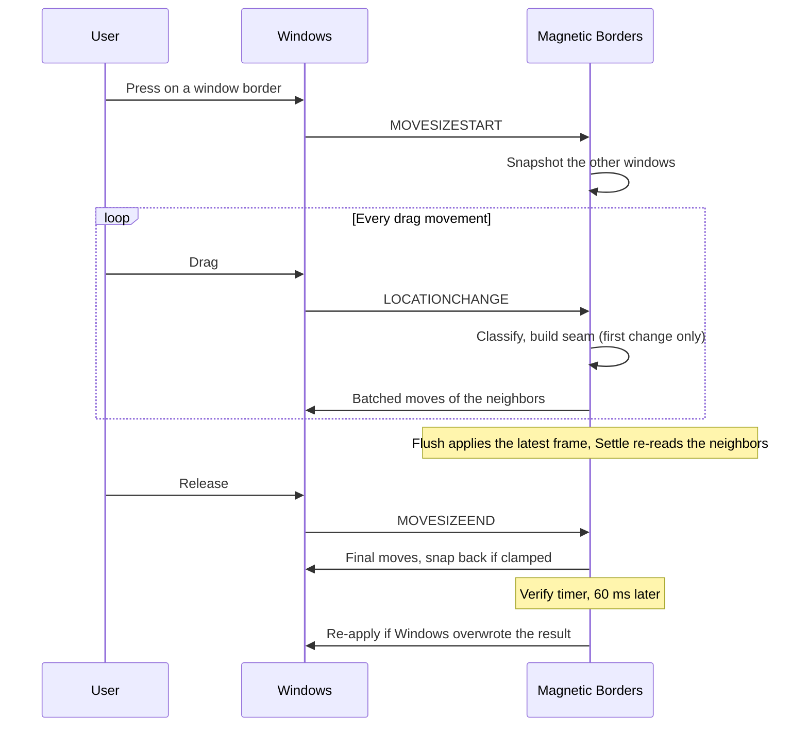

# How it works

When you drag the border of a window, Windows resizes only that window. Magnetic Borders monitors Windows events and catches when this happens. You and Windows resize the target application window; Magnetic Borders resizes the other windows yours touches to match.

## High-level flow

1. **You grab a border.** Windows starts its own resize loop and announces it. The Magnetic Borders hears about it through a [WinEvent hook](watching-windows.md).
2. **Magnetic Borders takes a snapshot.** It records where every other window is using the [true visible position](window-position.md) of each.
3. **The first movement tells it what you are doing.** If only the window's position changed, you are moving it, and MB ignores the drag. If the size changed, you are resizing. The sides that changed are the borders you grabbed.
4. **It builds a [seam](seams.md).** A seam is the list of window edges that sit on the same line as the border you grabbed.
5. **Every movement is copied to the seam.** Magnetic Borders works out the new position of each neighbor and [moves them all in one batch](moving-windows.md).
6. **You let go.** MB applies the final positions, snaps your window back if a neighbor hit a min/max limit, and double-checks a moment later with a [timer](timers.md).

## One drag, start to finish

The same flow as a sequence, for a single resize drag.

